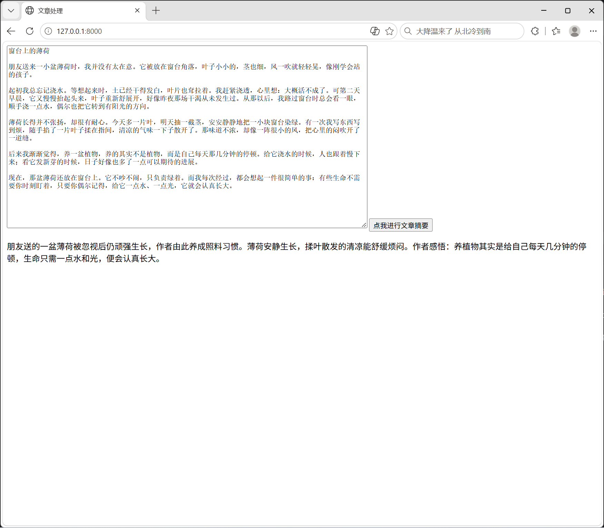

# AI 文章摘要

把一篇文章粘进去，几秒后得到100字以内的中文摘要。

## 功能
- 网页输入文章，一键生成摘要
- 请求失败时有明确提示，不会让用户对着"正在处理"干等

## 技术栈
- **FastAPI + Uvicorn** — 提供 HTTP 接口
- **DeepSeek API** — 生成摘要
- **原生HTML + JS** — 前端页面，没有用框架

## 怎么跑
1. 安装依赖：`pip install -r requirements.txt`
2. 设置 API key：`setx LLM_API_KEY "sk-你的key"`，然后**重开终端**
3. 启动：`uvicorn app:app --reload`
4. 打开 http://127.0.0.1:8000

## 截图

## 已知限制
- 只做单次摘要，不保存历史
- 超长文章可能超出模型上下文限制